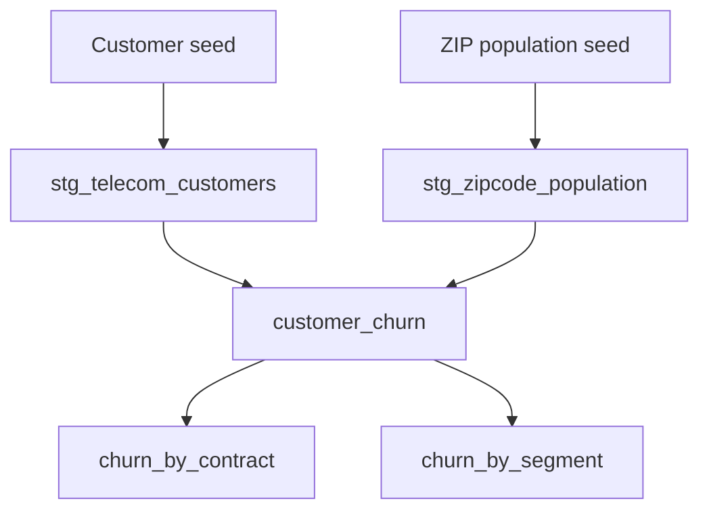

# Telecom Churn Reporting with dbt

**From raw customer records to tested reporting models.**


An analytics engineering project built with **dbt Core, DuckDB, SQL, and Jinja**. It cleans telecom customer data, adds geographic context, and produces reusable reporting tables for exploring customer churn.

| Customer records | ZIP-code records | SQL models | Configured tests |
| ---: | ---: | ---: | ---: |
| 7,043 | 1,671 | 5 | 12 |

[Overview](#overview) · [Pipeline](#pipeline) · [Findings](#findings) · [Data quality](#data-quality) · [Run locally](#run-locally)

## Overview

**Which customer groups have a higher percentage of churned customers in this dataset?**

This project answers that question through consistent cleaning, explicit metric definitions, and reusable SQL models. It explores customer churn by **contract, tenure, age, internet type, and ZIP-code population**.

### What I built

- Two staging models that clean and standardize source data.
- A customer-level reporting model joining customer and population records.
- Contract and segment summaries with consistent churn calculations.
- Jinja-based SQL to reuse reporting logic across four segment dimensions.
- Data-quality tests for keys, required fields, customer statuses, and relationships.

## Pipeline



Staging models are materialized as **views**; reporting models are materialized as **tables**.

| Model | Purpose |
| --- | --- |
| `stg_telecom_customers` | Standardize fields and types, normalize service labels, and flag negative monthly charges. |
| `stg_zipcode_population` | Prepare ZIP-code keys and population values. |
| `customer_churn` | Join customer and population records; add age, tenure, and population groups. |
| `churn_by_contract` | Report customer counts, churn percentages, and valid average monthly charges by contract. |
| `churn_by_segment` | Report churn by age, tenure, internet type, and population using reusable Jinja logic. |

## Findings

The following values are calculated from the supplied customer snapshot:

| Customer group | Total customers | Churned customers | Churn percentage |
| --- | ---: | ---: | ---: |
| Month-to-month contract | 3,610 | 1,655 | 45.84% |
| One-year contract | 1,550 | 166 | 10.71% |
| Two-year contract | 1,883 | 48 | 2.55% |
| Tenure of 0–12 months | 2,186 | 1,037 | 47.44% |
| Tenure of 49+ months | 2,239 | 213 | 9.51% |
| Age 65+ | 1,142 | 476 | 41.68% |
| Fiber optic internet | 3,035 | 1,236 | 40.72% |

Month-to-month contracts and customers in their first year show higher churn percentages than the comparison groups. These patterns can guide further retention analysis; they do **not** establish causes of churn.

Rows from different segmentation dimensions overlap and should not be added together.

### Metric definition

```text
Churn percentage = 100 × churned customers / all customers in the group
```

The denominator includes **Stayed, Churned, and Joined** customers. This describes the supplied snapshot, rather than a longitudinal churn rate.

## Data quality

### Cleaning decisions

| Issue | Handling |
| --- | --- |
| ZIP codes may contain leading zeros | Preserve ZIP codes as text in both seeds and models. |
| Inconsistent service labels | Standardize labels for customers without internet service. |
| Negative monthly charges | Retain and flag original values; exclude them from charge averages through `monthly_charge_for_analysis`. |
| Comparable reporting segments | Define age, tenure, and population groups in the customer-level model. |

### Configured tests

The model schema defines **12 data tests**:

| Test type | Count | Purpose |
| --- | ---: | --- |
| `unique` | 3 | Check customer and ZIP-code keys. |
| `not_null` | 7 | Check required keys, statuses, and population fields. |
| `accepted_values` | 1 | Restrict customer status to Stayed, Churned, or Joined. |
| `relationships` | 1 | Check customer ZIP codes against the population model. |

Run `dbt build` to load **2 seeds**, build **5 models**, and execute these tests. Its output reports the result of your current run.

## Run locally

### 1. Clone and install

Use a Python environment compatible with the pinned packages in [`requirements.txt`](requirements.txt).

```bash
git clone https://github.com/tasneemsaleh23/telecom-churn-dbt.git
cd telecom-churn-dbt
python -m pip install -r requirements.txt
```

### 2. Configure the dbt profile

Add this entry to `~/.dbt/profiles.yml` (Windows: `%USERPROFILE%\.dbt\profiles.yml`). Preserve any existing profiles in that file.

```yaml
telecom_churn:
  target: dev
  outputs:
    dev:
      type: duckdb
      path: dev.duckdb
      schema: main
      threads: 4
```

The relative path creates `dev.duckdb` in the directory from which you run dbt. No external database server is required.

### 3. Build and validate

```bash
cd telecom_churn
dbt debug
dbt build
```

### 4. Explore documentation and lineage

```bash
dbt docs generate
dbt docs serve
```

Open the URL printed by dbt to explore model documentation and lineage.

### Example reporting query

After building, run this in a SQL client connected to `dev.duckdb`:

```sql
select
    contract,
    total_customers,
    churned_customers,
    churn_pct_all_customers
from main.churn_by_contract
order by churn_pct_all_customers desc;
```

## Repository guide

| Path | Contents |
| --- | --- |
| [`requirements.txt`](requirements.txt) | Pinned Python dependencies. |
| [`telecom_churn/dbt_project.yml`](telecom_churn/dbt_project.yml) | Project settings and materializations. |
| [`telecom_churn/seeds/`](telecom_churn/seeds/) | Customer and population CSV files. |
| [`telecom_churn/models/staging/`](telecom_churn/models/staging/) | Cleaning and standardization models. |
| [`telecom_churn/models/marts/`](telecom_churn/models/marts/) | Customer-level data and churn reporting. |
| [`telecom_churn/models/schema.yml`](telecom_churn/models/schema.yml) | Model descriptions and data tests. |
| [`telecom_churn/reference/telecom_data_dictionary.csv`](telecom_churn/reference/telecom_data_dictionary.csv) | Source field definitions. |

## Scope and next steps

This project produces reporting models for an educational customer-churn dataset. It does not include a predictive model, a live dashboard, or a production deployment.

Possible extensions include richer model documentation, additional charge-validation tests, and a dashboard built on the reporting tables.

---

**Tasneem Saleh** · [GitHub](https://github.com/tasneemsaleh23) · [Portfolio](https://tasneem-retro-bytes.lovable.app)
